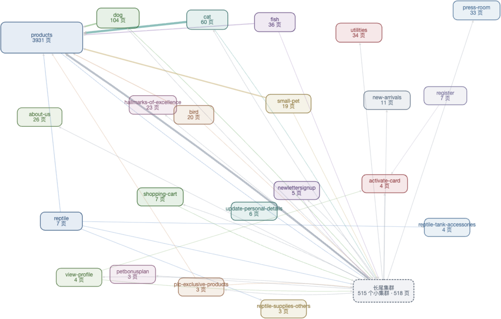
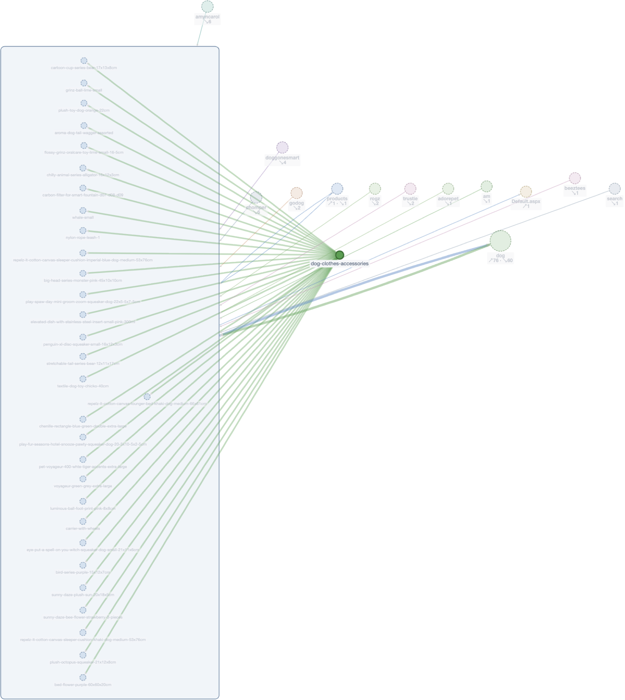
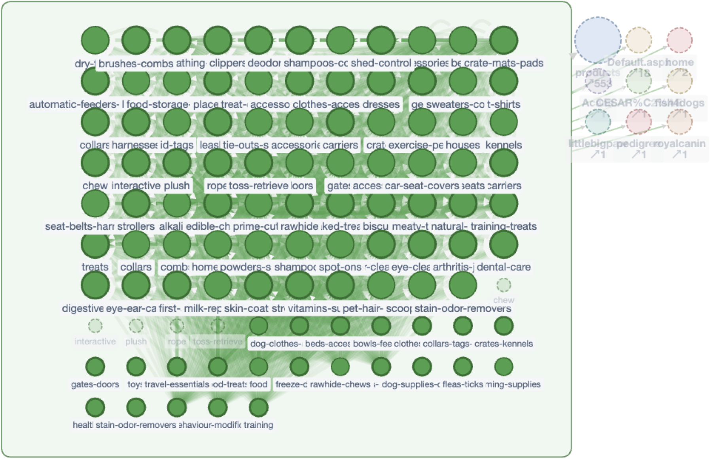

# Link Topology Explorer

**An internal link visualization tool: crawl any website, visualize its internal linking structure as an interactive graph, and export the link graph as CSV edge lists, GEXF, GraphML, JSON, or PNG.**

English · [简体中文](README.zh-CN.md)

  



## What it is

A three-step pipeline in one repo, generic enough to run against **any website** — no site-specific configuration, zero runtime dependencies (Node ≥ 22, no `npm install` needed):

1. **Crawl** — `link-topology.mjs` discovers pages from `/sitemap.xml` or a sitemap index (falls back to BFS crawling from the root page when the site has no sitemap), fetches every page, and extracts anchor-scope internal links only (`src`, canonicals, external links and asset extensions are ignored).
2. **Analyze** — builds the page → page adjacency graph, clusters pages by URL path segments, and derives the metrics that matter for internal linking audits: in/out degree per page, orphan pages, zero-outlink dead ends, top-linked pages, cross-cluster flows, and crawl failures. Site-wide navigation links (header/footer menus — "chrome" edges) are detected **data-driven** (any target linked from ≥ 90% of crawled pages) and separated from content links, so hub metrics aren't polluted by menus.
3. **Visualize & export** — `render-html.mjs` compiles everything into a **single-file interactive report** (`topology.html`). Cytoscape.js + fCoSE are inlined at build time, so the artifact works offline, opens from disk, and never phones home.

## Use cases

- **Internal linking audits (SEO)** — find orphan pages, over-linked hubs, one-way silos and dead-end pages before they cost you rankings. This is the internal link graph tool for quick, evidence-based linking decisions.
- **AI-friendly exports** — export internal links as an edge list (CSV): one row per `from → to` link with count and type. A flat edge list is the easiest internal-links format for LLMs, scripts and notebooks to parse; the raw JSON adjacency gives full fidelity for custom tooling.
- **Graph analysis in Gephi / Cytoscape / NetworkX** — GEXF export (nodes carry cluster colors, in/out degree, sitemap flags) opens natively in Gephi; GraphML export works in Cytoscape desktop, yEd and NetworkX. Crawl a website, export its link graph, continue in your favorite graph toolbox.
- **SEO crawler with CSV exports** — pages, edges and clusters as three Excel-ready CSVs (UTF-8 BOM) for reporting and diffing between crawl dates.



## Quick start

```bash
git clone https://github.com/partick33/link-topology-explorer.git
cd link-topology-explorer

# 1) Crawl + analyze  → ./out/topology.json (+ cluster-level Mermaid)
node link-topology.mjs https://example.com --out ./out

# 2) Compile the interactive single-file report
node render-html.mjs --dir ./out

# 3) Open ./out/topology.html in a browser — everything is inlined
```

Run the test suite (12 unit + end-to-end tests against a local http server, `fetch` injectable):

```bash
npm test
```

### Crawler options

| Option | Default | Meaning |
|---|---|---|
| `--sitemap <url>` | auto-probe | Explicit sitemap URL (tries `/sitemap.xml`, then `/sitemap-index.xml` + child sitemaps) |
| `--out <dir>` | `node_modules/.cache/link-topology` | Output directory |
| `--concurrency <n>` | 6 | Parallel fetches |
| `--timeout-ms <n>` | 15000 | Per-request timeout (1 retry) |
| `--chrome-threshold <f>` | 0.9 | Navigation-edge detection threshold |
| `--cluster-depth <n>` | 1 | Path segments per cluster |
| `--max-pages <n>` | 500 | BFS fallback page cap |
| `--full` | off | Also emit page-level `topology-full.mmd` |
| `--include-chrome` | off | Keep navigation edges (dashed) in Mermaid output |

## The interactive report

Three coordinated views, one file:

- **Cluster view** — every cluster as a card (page count, cross-cluster in/out), force-directed overview of the whole site.
- **Page view** — page-level graph with clusters as compound boxes; dotted "ghost" nodes for non-sitemap pages; click to inspect any page's full in/out link lists; double-click to drill down.
- **Data view** — sortable tables: top in-degree pages, cross-cluster content edges, orphans, zero-outlink pages, crawl failures.

Level-of-detail labels (screen-constant HTML chips at overview zoom, canvas labels as you zoom in), a filter for edge weight, an "include site-wide navigation" toggle, and a fuzzy search (`/`) that routes any path straight to its node.



### Big-site mode (implicit category discovery)

Above ~1,500 pages a flat graph stops being readable, so the page view switches to a bounded, drill-down model — **cluster → category directory → category group graph**:

- For flat catalogs (e.g. an e-commerce site with 3,931 `/products/{slug}` pages and no path structure), categories are **recovered from the link structure itself**: every non-hub page is grouped by its strongest content in-link source. On the test site this reconstructs 268 category groups covering 92% of products, all ≤ 99 pages.
- The category directory panel exists **on both sides**: the mega-cluster shows all groups sectioned by source cluster, and each source cluster (dog / cat / fish / …) shows its own directory of groups — one consistent mental model from either side.
- Every render is bounded: groups render whole (typically ≤ 350 nodes), anything larger falls back to a rank view (top 250 by in-degree + an aggregated long-tail node); external references collapse into per-cluster aggregate blocks with summed in/out counts.
- Gestures are uniform everywhere: double-click a category page → its group graph; double-click an aggregate block → that cluster's default view; search routes any path to the right graph and selects it.

Dense category-tree graphs (1,000+ breadcrumb links) automatically switch to a deterministic grid layout — a 104-node / 1,930-edge cluster renders in ~265 ms.

## Exports

From the report's export menu (filenames `link-topology-<domain>-<date>.*`):

| Format | Contents | Best for |
|---|---|---|
| **Edge list CSV** | `from,to,count,type` per link (content / navigation) | AI & spreadsheet analysis — export internal links as an edge list |
| Pages CSV | path, cluster, in/out degree, inSitemap / orphan / zero-outlink flags | Audits, diffing crawls |
| Clusters CSV | per-cluster page count, internal links, cross-cluster in/out | Silo overviews |
| **GEXF** | directed graph, cluster colors + degree attributes (viz namespace) | Gephi |
| **GraphML** | directed graph with typed attributes | Cytoscape desktop, yEd, NetworkX |
| JSON | `topology.json` verbatim | Custom tooling |
| PNG | current view (with overlays) or the full layout | Docs and decks |

CSVs carry a UTF-8 BOM so Excel opens them directly.

## Anti-bot sites (Cloudflare etc.)

Sites behind interactive challenges can't be fetched with Node's `fetch` (TLS fingerprint mismatch — even a valid `cf_clearance` cookie won't help). The supported path: pass the challenge in a real browser, then inject that page's `fetch` into the collector from the console — `collectTopology({ fetchImpl })` accepts any fetch implementation. On the reference crawl this recovered 930/931 pages of a Cloudflare-protected site; the single failure (a login-only member page) is recorded in `fetchFailures` like any other.

## Project layout

```
link-topology.mjs       crawler + graph analysis + Mermaid (CLI)
render-html.mjs         compiles topology.json → single-file interactive report
report-ui/app.js|css    report UI source (inlined at build)
link-topology.test.mjs  unit + end-to-end tests
```

## License

[MIT](LICENSE)
